# BuilderXray

> *"Brochure mein sab luxury hai. We show you the RERA filing."*

Built by **Team Hardcoders** (**Tejas Lamba** and **Kanishka Das**) for **Kritical Hacks 2026, IGDTUW Delhi (AI/ML Track)**.

**BuilderXray** is an AI web-agent due-diligence engine powered by **TinyFish**. Give it one real-estate builder name or RERA number. It dispatches parallel web agents across **6 API-less Indian government and legal portals**. In about **90 seconds** it compiles an evidence-linked **0-100 Cricket Scorecard** and a **Brochure-vs-RERA "Doglapan Detector"** report. Every claim links to the government URL it came from.

---

## Table of contents

1. [Problem and real-world impact](#1-problem-and-real-world-impact)
2. [Solution and key innovations](#2-solution-and-key-innovations)
3. [Deep TinyFish integration](#3-deep-tinyfish-integration)
4. [Unit economics](#4-unit-economics)
5. [Revenue model and Year-1 target](#5-revenue-model-and-year-1-target)
6. [Tech stack, local setup and Docker](#6-tech-stack-local-setup-and-docker)
7. [Honest current status](#7-honest-current-status)
8. [Team and license](#8-team-and-license)

---

## 1. Problem and real-world impact

An Indian homebuyer puts **₹50L to ₹2Cr** of life savings into a flat. The decision usually rests on a glossy WhatsApp brochure. Meanwhile **4.5 lakh+ housing units remain delayed or stalled across the top 7 Indian cities**.

The facts that would protect the buyer are public. They are scattered across portals built to resist automation:

| Source | What it holds | Why it is hard to automate |
|---|---|---|
| **28+ state RERA portals** (HRERA, MahaRERA, UP-RERA, DL-RERA, ...) | Registered projects, promised possession dates, phase approvals, quarterly updates, complaints | No public API. Every state has a different layout. Many use ASP.NET session walls. Key data sits in PDFs. |
| **eCourts** | Civil suits against the builder entity | Party-name search needs court jurisdiction, year and a CAPTCHA |
| **NCDRC / e-Daakhil** | Consumer complaints | Fragmented forums, CAPTCHAs, order PDFs |
| **MCA21** | Company CIN, director DINs, charges | CAPTCHA-gated master-data search |
| **Indian Kanoon and news** | Court orders, delay and litigation coverage | Unstructured, name-ambiguous |

No buyer, broker or small lender can reasonably check all of this before signing. BuilderXray does it in one query, with citations.

---

## 2. Solution and key innovations

| Innovation | What it does |
|---|---|
| **0-100 Cricket Scorecard** (`OUT` / `DRS` / `NOT OUT`) | One instant buyer verdict, backed by cited government URLs. `OUT` means walk away. `DRS` means review before you commit. `NOT OUT` means no red flags found in the sources actually checked. |
| **Doglapan Detector** (Brochure vs RERA filing diff) | Side-by-side comparison of marketing claims (possession date, phase approvals, amenities, litigation) against the official RERA filing. Every mismatch carries a source link. |
| **Cross-Portal Entity Graph** | Joins the builder's brand name to its MCA21 CIN and director DINs, RERA registration IDs, eCourts civil suits and NCDRC consumer complaints. Brand names, SPVs and group companies resolve to one entity. |
| **"Unknown ≠ Clean" epistemic honesty** | If a portal times out, is unreachable or demands a manual CAPTCHA, that source is reported as **unknown**. It is never scored as a clean chit. A verdict is only issued when the RERA source for the report's state was actually assessed. We do not bypass CAPTCHAs. |

```mermaid
flowchart LR
    U["Buyer / lender / broker<br/>builder name or RERA no."] --> API["FastAPI<br/>POST /api/check"]
    API --> JOB["Async job runner<br/>SSE progress stream"]

    subgraph FAN["Async fan-out: 6 sources in parallel"]
        direction TB
        S1["1. State RERA<br/>HRERA / DL-RERA<br/>Search + Fetch"]
        S2["2. MCA21<br/>CIN + director DINs<br/>Web Agent"]
        S3["3. eCourts<br/>civil suits"]
        S4["4. Indian Kanoon<br/>court orders<br/>Search + Fetch"]
        S5["5. NCDRC / e-Daakhil<br/>consumer complaints"]
        S6["6. News<br/>delay / litigation<br/>Search"]
    end

    JOB --> FAN
    FAN --> ENT["Entity engine<br/>brand ↔ CIN ↔ DIN ↔ RERA ID"]
    FAN --> DIFF["Diff engine<br/>brochure claims vs RERA filing"]
    ENT --> SC["0-100 Cricket Scorecard<br/>OUT / DRS / NOT OUT<br/>unknown ≠ clean"]
    DIFF --> SC
    SC --> UI["Next.js report<br/>cited evidence per claim"]
```



---

## 3. Deep TinyFish integration

TinyFish is the data layer. Without it there is no product, because none of the six sources offers an API.

| TinyFish primitive | Endpoint | Role in BuilderXray | Code |
|---|---|---|---|
| **Web Agent** | `agent.tinyfish.ai/v1/automation/run-async` | Multi-step form navigation and stateful extraction on MCA21 and RERA portals. Runs are submitted async, then polled at `/v1/runs/{run_id}` until a terminal state (`FAILED`, `CANCELLED` and `TIMED_OUT` become **unknown**, never clean). | `backend/app/sources/agent.py`, `backend/app/sources/mca.py` |
| **Search API** | `api.search.tinyfish.ai` | Domain-scoped discovery across `rera.haryana.gov.in`, `rera.delhi.gov.in`, `indiankanoon.org`, `ecourts.gov.in`, `ncdrc.nic.in`, plus news (`location=IN`). Results are restricted to the official domain and checked against the query. | `backend/app/sources/tinyfish_search.py`, `court.py`, `news.py` |
| **Fetch API** | `api.fetch.tinyfish.ai` | Converts stateful RERA project tables, order PDFs and news articles into clean markdown for extraction and diffing. | `backend/app/sources/tinyfish_search.py`, `rera.py` |
| **Cloud Browser** (Playwright/CDP) | TinyFish browser session | Session-aware portal inspection. Human-in-the-loop CAPTCHA fallback: the operator solves the CAPTCHA, the agent continues. Today, CAPTCHA-gated sources are linked for manual completion. See [status](#7-honest-current-status). | Fallback path for `mca.py` and `court.py` |

**Why this needs TinyFish and not `requests`.** The portals use session cookies, postbacks and JS-rendered tables. Search + Fetch handle the fast read-only path (about seconds per source). The Web Agent handles the stateful multi-step path. A single report mixes both inside one async fan-out.

---

## 4. Unit economics

**BuilderXray Dhaba Receipt: one fresh report**

| Line item | Basis | Cost |
|---|---|---|
| TinyFish Agent steps | ~90 steps × $0.016 | **₹127** |
| LLM / extraction tokens | claim extraction + diff | **₹15** |
| Hosting and storage | single container + report cache | **₹8** |
| Payment gateway | 2% of ₹999 | **₹20** |
| **Total fresh crawl cost** | | **₹170** |
| **Retail price** | | **₹999** |
| **Gross margin** | (999 − 170) / 999 | **83%** |

**Cached Kundli Scan (2nd to 100th buyer of the same builder).** The crawl is shared, so only the cost of re-scoring and serving applies: **₹15 cost, 98.5% gross margin**.

Builders repeat. Popular builders are queried again and again, so blended margin moves toward the cached figure as volume grows.

*Assumes ~₹88/USD. TinyFish step pricing and the ~90-step count are our planning estimates, not a quoted contract.*

---

## 5. Revenue model and Year-1 target

| Segment | Product | Price | Year-1 volume | Revenue |
|---|---|---|---|---|
| **B2C homebuyer** | Single report | ₹999 / report | 5,000 reports | ₹50L |
| | Pro (3 builders + 12-month litigation and delay watch) | ₹2,499 | included in the 5,000 mix | |
| **B2B bank / HFC underwriting API** | Automated project-risk underwriting | ₹299 / API call | 2 lenders × 10k calls | ₹60L |
| **B2B broker and NRI desk (white-label)** | Branded report portal | ₹9,999 / month | 50 brokers × 12 months | ₹60L |
| **Total Year-1 ARR** | | | | **₹1.7 Crore** |

Lenders are the highest-value wedge: they already pay for manual legal due diligence and need a fast first-pass filter. Brokers and NRI desks need to answer "is this builder safe?" for buyers who cannot visit a registrar's office.

---

## 6. Tech stack, local setup and Docker

**Stack:** FastAPI + Uvicorn, Pydantic 2, httpx (async), RapidFuzz (entity matching) · Next.js 16 / React 19 / Tailwind 4, statically exported and served by FastAPI · TinyFish Web Agent, Search and Fetch · optional Anthropic Claude for news classification · single Docker container.

### Environment

```bash
cp .env.example .env
```

| Variable | Purpose |
|---|---|
| `TINYFISH_API_KEY` | TinyFish key. Can also be set from **Connections** in the local UI. It is written to `.env` server-side and never returned to the browser. |
| `ANTHROPIC_API_KEY`, `CLAUDE_MODEL` | Optional. News classification and page validation. |
| `DEMO_MODE` | `auto` (default: live if a key is present, else saved reports) or `replay` (always use fixtures). |
| `LIVE_PASSCODE` | Required for remote live runs. Local runs use the configured key directly. |
| `MAX_LIVE_RUNS_PER_DAY` | Daily cap on live runs (default `30`). Protects the TinyFish budget. |

### Backend

```bash
cd backend
python -m venv .venv && source .venv/bin/activate   # Windows: .venv\Scripts\activate
pip install -r requirements.txt
uvicorn app.main:app --reload --port 8000
```

### Frontend

```bash
cd frontend
npm ci
npm run dev      # hot reload; dev config proxies /api to port 8000
npm run build    # static export to frontend/out, served by FastAPI
```

Run `npm run build` once, then `uvicorn` serves the whole app at `http://localhost:8000`.

### Tests

```bash
cd backend
pip install pytest
pytest
```

### Docker (single container)

```bash
docker build -t builderxray .
docker run -p 8000:8000 --env-file .env builderxray
```

The multi-stage `Dockerfile` builds the frontend with Node 22, then ships it inside a `python:3.11-slim` image. The service listens on `$PORT` when the host sets it. Deploy on Render, Railway or Fly.io and set the environment variables there. `.env` is excluded from both Git and the Docker context.

### API

| Route | Purpose |
|---|---|
| `GET /api/health` | Liveness |
| `POST /api/check` | Start a check job |
| `GET /api/jobs/{job_id}` | Job state |
| `GET /api/jobs/{job_id}/events` | Live progress stream |
| `GET /api/reports`, `GET /api/reports/{report_id}` | Saved reports |

---

## 7. Honest current status

We label what is live and what is not, because the product's whole premise is that unknown is not clean.

- **Live today:** TinyFish Search and Fetch find and read official Haryana RERA project pages directly. Results are restricted to the official state portal and checked against the query. TinyFish Search powers news discovery. News stays partial until Claude classification and page validation are configured.
- **Unknown, not clean:** Delhi RERA can be unreachable through TinyFish. That produces an **unknown** verdict, never a clean one.
- **Manual by design:** MCA company/LLP master data and eCourts party-name search both require a CAPTCHA. BuilderXray does **not** bypass CAPTCHAs and does not claim an automated result for them. Reports link directly to the official search page. The Cloud Browser human-in-the-loop flow is the designed path for closing this gap.
- **Saved reports:** Without a TinyFish key, or with `DEMO_MODE=replay`, checks use dated fixtures from public Haryana RERA records. Each fixture claim has a direct source URL. Saved reports are not a live check.
- **Tests:** `backend/tests/` is not yet in the repo, so `pytest` collects nothing until tests are added.
- **Economics and revenue** figures above are planning estimates, not measured results.

---

## 8. Team and license

**Team Hardcoders** · Tejas Lamba · Kanishka Das · Kritical Hacks 2026, IGDTUW Delhi, AI/ML Track.

Released under the [MIT License](LICENSE).
